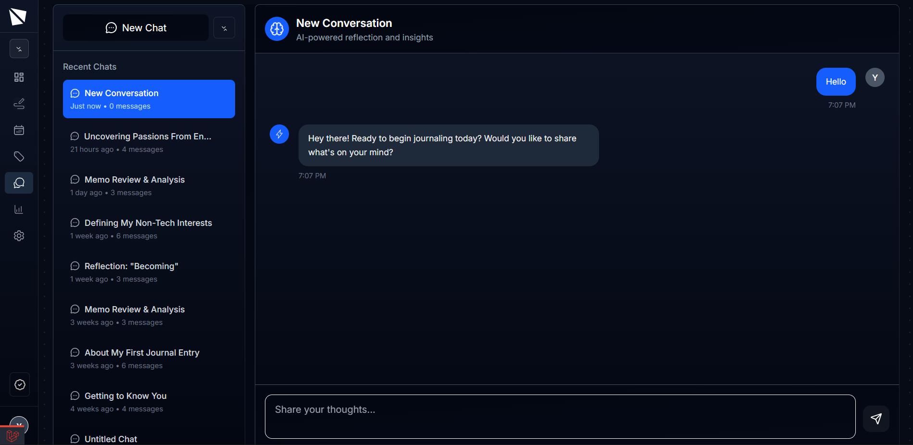

# Lumina

Lumina is an ambient, reflective journaling platform designed to turn daily writing into a calm, mindful sanctuary. Built with Laravel, Livewire, and Tailwind CSS, Lumina combines distraction-free journaling with conversational AI reflections, ambient soundscapes, and personal writing insights.

---

## Overview

Most note-taking applications feel either like rigid productivity databases or plain text scratchpads. Lumina was designed for those who want an intentional, peaceful space to record their thoughts, untangle complex emotions, and gain perspective on their personal journey over time.

---

## Core Capabilities

### Reflective Journaling
- **Distraction-Free Workspace:** A minimalist editor designed to keep your focus entirely on your writing.
- **Customizable Typography:** Switch seamlessly between curated fonts (Playfair, Inter, Lora, Caveat, Merriweather, JetBrains Mono) with real-time font size scaling.
- **Mood Tracking & Tagging:** Categorize thoughts with moods and custom tags for organized recall.
- **Timezone Awareness:** Automatic browser timezone detection ensuring every entry aligns accurately with your local calendar day.

### Conversational AI & Guided Reflection
- **Interactive Reflection Partner:** Discuss entries with an AI companion directly from your entry screen or via Quick Chat to uncover fresh perspectives.
- **Weekly Retrospectives:** Generate structured summaries and discover emerging patterns across your writing.
- **Multi-Model Support:** Connects cleanly to modern AI providers (Google Gemini, Hugging Face, OpenAI).

### Ambient Soundscapes (Sanctuary Music)
- **Integrated Music Player:** Curated lofi and ambient tracks designed to deepen concentration while journaling.
- **Persistent Sidebar Dock:** Expandable player dock that stays active uninterrupted across SPA page transitions.
- **Zero-Latency Playback:** Edge-cached audio streams with progressive prebuffering and seamless continuous playback.

### Voice Narration & Exporting
- **Voice Narration:** High-fidelity text-to-speech powered by ElevenLabs to listen back to your personal reflections.
- **PDF Export:** Generate clean, formatted printable archives of your journal entries.

### Organization & Discovery
- **Instant Search:** Full-text indexing to quickly search through past thoughts and memos.
- **Habit Tracking:** Dashboard metrics displaying streaks, total words, active days, and mood trends.

---

## Looks

---

## Tech Stack

- **Backend:** Laravel 12 (PHP 8.3)
- **Frontend:** Livewire 3, Alpine.js, Tailwind CSS
- **Database:** PostgreSQL / SQLite
- **AI & Media:** Google Gemini API, ElevenLabs TTS, Web Audio API
- **Deployment:** Caddy & Vercel Edge

---

## License

This project is open-source software licensed under the [MIT License](LICENSE).
